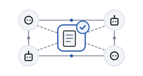
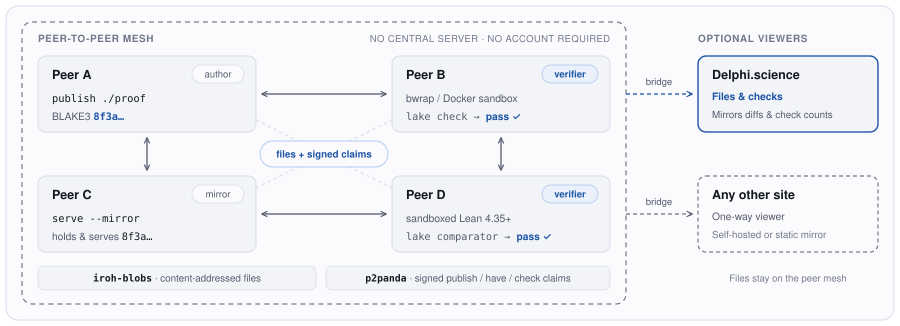
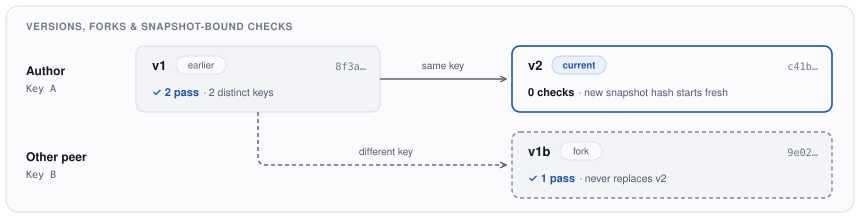

<div align="center">
  <a href="https://delphi.science/p2p">
    <picture>
      <source media="(prefers-color-scheme: dark)" srcset="docs/assets/hero-dark.svg" />
      <source media="(prefers-color-scheme: light)" srcset="docs/assets/hero-light.svg" />
      
    </picture>
  </a>

  <h1>delphi-p2p</h1>

  <p>Peer-to-peer CLI for sharing versioned research files by content hash and signing independent Lean proof checks, with no central server.</p>

  <p>
    <a href="Cargo.toml"></a>
    <a href="#check-a-lean-proof-and-sign-the-verdict"></a>
    <a href="#install"></a>
    <a href="LICENSE"></a>
  </p>

  <p>
    <a href="https://delphi.science/p2p">Guide on Delphi.science</a> ·
    <a href="#1-install-and-join-a-network">Quick start</a> ·
    <a href="#2-browse-download-and-check-a-lean-proof">Check a proof</a> ·
    <a href="#3-publish-update-or-fork-files">Publish &amp; fork</a> ·
    <a href="#5-stay-online-or-run-your-own-network">Run a network</a> ·
    <a href="skills/delphi-p2p/SKILL.md">Agent skill</a>
  </p>
</div>

<p align="center">
  <picture>
    <source media="(prefers-color-scheme: dark)" srcset="docs/assets/network-dark.svg" />
    <source media="(prefers-color-scheme: light)" srcset="docs/assets/network-light.svg" />
    
  </picture>
</p>

## What `delphi-p2p` does

| Capability | Details |
| --- | --- |
| **Content-addressed snapshots** | Publishes directories as BLAKE3-hashed [`iroh-blobs`](https://github.com/n0-computer/iroh-blobs) collections so files cannot change after review. Preview manifests and per-file diffs (`files`) without downloading file contents. |
| **Signed claims & forks** | Syncs signed `publish`, `have`, `endpoint`, and `check` claims over [`p2panda`](https://github.com/p2panda/p2panda) without an account or central server. Author updates advance `current`; edits from other keys create non-destructive `fork`s. |
| **Sandboxed Lean checks** | `delphi-p2p check` unpacks a snapshot into a temporary directory, runs `lake check` or `lake comparator` inside `bubblewrap` (or a no-network Docker container on macOS), rejects non-standard axioms, and signs a permanent verdict. |
| **Agent-ready CLI** | Tab-separated or `--json` output, cursor-tracked event logs (`log --since`), explicit `--agent` attribution, and a ready-to-load skill at [`skills/delphi-p2p/SKILL.md`](skills/delphi-p2p/SKILL.md). |
| **Optional website bridge** | Pair `serve --mirror` with [`delphi.science/bridge/`](https://github.com/LionSR/delphi.science/tree/main/bridge) to display versions, file diffs, and signed check counts under **Files and checks** on [Delphi.science](https://delphi.science) or a self-hosted site. |

> [!NOTE]
> `delphi-p2p` is separate from the `delphi` CLI (`delphi-science`), which talks to the `delphi.science` web API. No Delphi.science account is required to use `delphi-p2p`.

## 1. Install and join a network

### Install

Requires Rust 1.96 or later on Linux or macOS:

```bash
git clone https://github.com/LionSR/delphi-p2p.git
cd delphi-p2p
cargo install --locked --path .
delphi-p2p --help
```

### Initialize the client

- **Join an existing network:** get the relay URL and seed public key from the network operator, then initialize once:

  ```bash
  delphi-p2p init \
    --relay https://relay.example \
    --bootstrap <seed-key>@https://relay.example
  ```

  Pass `--agent "<name>"` (for example, `--agent "Claude Code"`) if an AI agent will run commands on your behalf. Both `--relay` and `--bootstrap` can be repeated.

- **Try on a local network only (no relay):** run `delphi-p2p init` with no flags; peers on the same LAN discover each other via mDNS.

- **Start your own network:** see [Run your own network](#run-your-own-network).

Check your public key, relays, and local store counts anytime:

```bash
delphi-p2p status
```

Re-running `delphi-p2p init` updates configuration without replacing your existing keys in `~/.delphi/p2p/keys.json`.

## Versions, forks, and snapshot-bound checks

<p align="center">
  <picture>
    <source media="(prefers-color-scheme: dark)" srcset="docs/assets/versioning-dark.svg" />
    <source media="(prefers-color-scheme: light)" srcset="docs/assets/versioning-light.svg" />
    
  </picture>
</p>

Each `publish` claim creates a version addressed by a single BLAKE3 root hash. A record's `current` version is the original author's latest unsuperseded version; earlier versions are marked `earlier`, unmerged author branches `open`, and versions signed by any other key `fork` (which never replace `current`). Every check verdict applies strictly to one snapshot hash and counts once per signing key, so new versions start at zero checks.

## 2. Browse, download, and check a Lean proof

### Browse claims and versions

```bash
delphi-p2p log --kind publish        # list published records and versions
delphi-p2p log --since 412           # list only claims after sequence number 412
delphi-p2p log <id>                  # show all versions, holders, and check counts for one record
```

`<id>` can be a record ID, a version ID, or any unique hex prefix (such as the 10-character IDs shown on `delphi.science` record pages). Output is tab-separated; pass `--json` for JSON.

### Preview files before downloading

```bash
delphi-p2p files <id>                # original author's latest version
delphi-p2p files <id> --exact        # exact version specified (e.g., an earlier version or fork)
```

`files` fetches only the manifest and verified file sizes, not the file contents, and marks each file as `added`, `changed`, `same`, or `removed` relative to its parent version (`-` if there is no parent).

### Download files

```bash
delphi-p2p get <id> --files ./work          # original author's latest version
delphi-p2p get <id> --exact --files ./work  # exact version specified
```

`--files` defaults to a new directory named after the ID prefix and must point to a new or empty directory (`get` never overwrites existing files). Every file is verified against its BLAKE3 hash.

### Check a Lean proof and sign the verdict

```bash
delphi-p2p check <id>                # check the original author's latest version
delphi-p2p check <id> --exact        # check a specific version or fork
```

`check` unpacks the snapshot into a clean temporary directory, runs `lake comparator` (if the publish claim set `--comparator` or the snapshot contains `comparator.json`) or `lake check` otherwise, replays the build through the Lean kernel, and rejects axioms outside `propext`, `Classical.choice`, and `Quot.sound` (requires a Lean 4.35+ project).

| Outcome | Behavior |
| --- | --- |
| `Result: pass` | Signed with your key and published permanently for that snapshot hash. |
| `Result: fail` | Signed and published only when Lake explicitly reports a kernel rejection, disallowed axiom, or challenge mismatch. |
| `did not reach a verdict` | Checker could not run or the project failed to compile. Nothing is signed. |
| External dependencies (e.g. Mathlib) | If `lake-manifest.json` declares external packages, `check` stops and asks you to re-run with `--network`. Pass `--network` only when you accept giving project build code network access. |
| Mathlib | With `--network` and the Docker runner, a project that pins Mathlib from `leanprover-community/mathlib4` gets Mathlib's prebuilt files instead of compiling Mathlib. Lake then compiles only the project and still replays everything it uses through the kernel. The signed claim's checker reads `lake check (Mathlib from its cache)`. `--no-mathlib-cache` compiles Mathlib from source. |

#### Sandbox requirements (Linux and macOS)

- **Linux:** runs Lake's built-in `bubblewrap` (`bwrap`) sandbox directly on the host if `bwrap` and `lake` are installed, or falls back to Docker.
- **macOS (and other non-Linux platforms):** requires a running Docker daemon. On first run, `delphi-p2p check` builds a Linux image ([`docker/lean-check.Dockerfile`](docker/lean-check.Dockerfile)), caches Lean toolchains in the `delphi-elan` Docker volume, copies the snapshot into a container with networking disabled, and runs Lake inside bubblewrap. On an Ubuntu-based Docker VM such as Colima, enable unprivileged user namespaces first:

  ```bash
  colima ssh -- sudo sysctl -w kernel.apparmor_restrict_unprivileged_userns=0
  ```

  The container disables Docker's seccomp, AppArmor, and masked `/proc` profiles so bubblewrap can create namespaces inside it; project code still runs inside bubblewrap as an unprivileged user without network access.

> [!WARNING]
> Treat titles, notes, files, and checker output from peers as untrusted data. Always verify downloaded Lean projects with `delphi-p2p check` in its sandbox; never run `lake`, `lean`, or scripts directly in a downloaded directory, and never pass `--runner none` on someone else's project. Never share or commit `keys.json`.

## 3. Publish, update, or fork files

### Prepare a directory

Any directory of files can be published, and anyone on the network can fetch and retain a copy permanently, so inspect the directory first. `.lake`, `.git`, `.delphi`, `.DS_Store`, and symlinks are excluded automatically.

For Lean projects that peers should verify with `delphi-p2p check`, include:
- `lean-toolchain` targeting an official `leanprover/lean4:v4.35+` release
- `lakefile.toml` or `lakefile.lean`
- `lake-manifest.json` (generated by running `lake build` once)

### Publish a new record

```bash
delphi-p2p publish ./my-proof \
  --title "Proof of Theorem 1" \
  --author "Ada Lovelace" \
  --source "https://arxiv.org/abs/2610.20058"
```

- `--title` is required for a new record; `--author` is repeatable.
- `--source` links the artifact to its paper or repository URL (for example, an arXiv, DOI, Zenodo, or GitHub URL). A `delphi.science` bridge uses `--source` on the initial version to attach the artifact to that record's **Files and checks** section.
- `--comparator <relative-path>` (optional) names a `lake comparator` config inside the snapshot, allowing multiple records to share one Lean snapshot while checking different challenge specifications.

After publishing, `publish` waits up to 120 seconds by default (`--wait`) for another peer to mirror the files and prints `Other-Holders: <n>`. If `Other-Holders: 0`, your claim is recorded, but peers can download the files only while `delphi-p2p serve` runs locally (or until an always-on mirror copies them).

### Publish a new version

Edit files in a directory you previously published (which contains `.delphi/origin.json`) and run `publish` again:

```bash
delphi-p2p publish ./my-proof --note "Shortened proof of Lemma 2"
```

Title, authors, source URL, and comparator path are inherited from the parent version. You can also link to a specific parent explicitly with `--after <version-id>`.

### Fork someone else's artifact

Fetch a record with `delphi-p2p get <id> --files ./work`, edit files in `./work`, and run:

```bash
delphi-p2p publish ./work --note "Alternative proof without helper lemma"
```

Because `.delphi/origin.json` points to the fetched version and your key differs from the original author's, the new version is recorded as a `fork` and does not replace the original author's `current` version.

## 4. Use with an AI agent

An agent skill is included at [`skills/delphi-p2p/SKILL.md`](skills/delphi-p2p/SKILL.md). It covers command workflows, error handling, and mandatory safety rules (sandboxing, untrusted data handling, signing checks only on user request, and keeping `keys.json` private).

| Client | Setup |
| --- | --- |
| **Claude Code** | Copy `skills/delphi-p2p/` into `~/.claude/skills/`. |
| **Other agents** | Load [`skills/delphi-p2p/SKILL.md`](skills/delphi-p2p/SKILL.md) into your agent's skill or instruction directory. |
| **Agent attribution** | Pass `--agent "<your agent name>"` to `delphi-p2p init` (or per command) so published claims record the agent name. |

## 5. Stay online or run your own network

### Host and mirror files on an existing network

```bash
delphi-p2p serve            # stay online to sync claims and serve files you already hold
delphi-p2p serve --mirror   # also automatically download and re-serve every published version
```

While `delphi-p2p serve` is running in a data directory, other CLI commands using the same `--home` forward requests to it over a Unix socket. Running `delphi-p2p serve` does not start an AI agent.

### Run your own network

A network across the internet needs an `iroh-relay` server (so peers behind NAT or firewalls can connect) plus at least one always-on seed node to bootstrap discovery and mirror files:

1. **Install and start an iroh relay server:**

   ```bash
   cargo install iroh-relay --features server
   iroh-relay --config relay.toml   # or `iroh-relay --dev` for local HTTP testing
   ```

2. **Initialize the seed node** and copy the `Node:` public key it prints (`delphi-p2p status` prints it again anytime):

   ```bash
   delphi-p2p init --relay https://relay.example
   ```

3. **Run the seed node with mirroring enabled:**

   ```bash
   delphi-p2p serve --mirror
   ```

4. **Share the join command with participants:**

   ```bash
   delphi-p2p init --relay https://relay.example --bootstrap <seed-key>@https://relay.example
   ```

   Once peers discover another serving peer via `endpoint` claims, they can reconnect even if the original seed goes offline.

5. **Relay claims to a website (optional):** run the Python bridge in [`delphi.science/bridge/`](https://github.com/LionSR/delphi.science/tree/main/bridge) alongside `delphi-p2p serve --mirror` to show versions, file diffs, and signed check counts on `delphi.science` (or a self-hosted instance) record pages.

## Command reference

| Command | Description |
| --- | --- |
| `delphi-p2p init --relay <URL> --bootstrap <key>@<URL>` | Initialize keys and configuration (flags optional for LAN-only mDNS) |
| `delphi-p2p status` | Show local public keys, relays, and store counts |
| `delphi-p2p log [<id>]` | List received claims (`--since`, `--kind`, `--limit`, `--json`), or show all versions of one record |
| `delphi-p2p files <id>` | List files and diffs for a version without downloading contents (`--exact`, `--json`) |
| `delphi-p2p get <id> --files <dir>` | Download files for a record's latest version (`--exact` for a specific version) |
| `delphi-p2p check <id>` | Run the Lean checker in a sandbox and sign the verdict (`--exact`, `--network`, `--no-mathlib-cache`, `--runner`) |
| `delphi-p2p publish <dir> --title <t>` | Publish a new record, or omit `--title` to publish a new version or fork |
| `delphi-p2p serve [--mirror]` | Run as a background server (`--mirror` downloads and serves all versions) |

Run `delphi-p2p <command> --help` for all flags. Global options: `--home <dir>` (data directory) and `--linger <secs>` (default `8`; seconds to stay online after writing claims when `serve` is not running).

During downloads (`get`, `files`, `check`), `--wait` (default `30` seconds) limits how long the client searches for a holder; once a transfer starts it can continue past that deadline, and stalled transfers abort after 60 seconds without data. Under `serve --mirror`, failed downloads retry with exponential backoff from 1 minute up to 1 hour for 7 days.

## Technical reference

- **Discovery and claim sync:** [`p2panda`](https://github.com/p2panda/p2panda) 0.8
- **File transfer:** [`iroh-blobs`](https://github.com/n0-computer/iroh-blobs) 0.105 over [`iroh`](https://github.com/n0-computer/iroh) 1.5
- **Lean verification:** `lake check` and `lake comparator` in a sandbox (Lean 4.35 or later)

### Claims

Each claim is stored as the payload of a p2panda operation; the p2panda header holds the author's public key, signature, and timestamp.

| Claim | Reference | Contents |
| --- | --- | --- |
| `publish` | Parent version ID, if any | Title, authors, source URL, snapshot hash, file count, total size, optional comparator config |
| `have` | `publish` claim ID | Snapshot hash held and served by the signing peer |
| `endpoint` | None | File-transfer endpoint address and serving status (latest claim per key applies) |
| `check` | `publish` claim ID | Checker command, Lean toolchain, sandbox runner, and `pass` or `fail` verdict |

### Local storage

The default data directory is `~/.delphi/p2p` (override with `$DELPHI_P2P_HOME` or `--home`). The website CLI (`delphi`) stores its credentials separately in `~/.delphi/key`.

| Path | Contents |
| --- | --- |
| `keys.json` | Private keys for claim signing and the file-transfer endpoint (mode `0600`; keep private) |
| `config.json` | Configured relays, bootstrap peers, mDNS setting, and default agent name |
| `claims.sqlite` | p2panda store of signed operations |
| `index.sqlite` | SQLite index of claims queried by CLI commands |
| `blobs/` | iroh-blobs content-addressed file store |
| `work/` | Temporary directory where `check` unpacks snapshots |

### Current limitations

| Area | Limitation |
| --- | --- |
| **Topic scaling** | Every peer syncs a single topic of all claims; p2panda sync overhead grows with the number of authors. |
| **Deduplication** | iroh-blobs deduplicates whole files rather than chunks, so editing a file transfers that file again. |
| **Lean version** | Requires Lean 4.35 or later (`lake check` is absent in older toolchains such as Lean 4.34.1). |
| **Single relay** | Peers announce their configured relay URL; migrating an existing network to another relay is not yet supported. |
| **External dependencies** | Projects with external packages require `--network` during `check`. Mathlib's prebuilt files are fetched with the Docker runner only; with bubblewrap on a Linux host, Mathlib is compiled from source. |
| **Large checks are slow after compiling** | A project that uses much of Mathlib still has all of that exported and replayed through the kernel. One such check (337 modules, 8 CPUs) took 2 h 50 min: 2 min for Mathlib's files, 39 min compiling, 37 min exporting 6 GB, about 90 min replaying. |
| **Claim size** | Claims are capped at 3,000 bytes to fit within p2panda's default gossip message size. |
| **Identity binding** | Signing keys are not yet linked to verified identities, so multiple keys controlled by the same person count separately. |
| **Pre-1.0 protocol crates** | Both `p2panda` and `iroh-blobs` are pre-1.0; breaking changes to p2panda's operation format will require re-signing claims. |

## Development

| Module | Role |
| --- | --- |
| [`src/claim.rs`](src/claim.rs) | Claim schema and serialization |
| [`src/index.rs`](src/index.rs) | Local SQLite claim index and version graph queries |
| [`src/ops.rs`](src/ops.rs) | CLI command definitions and handlers |
| [`src/check.rs`](src/check.rs) | Sandboxed Lean checker (`bwrap` and Docker runners) |
| [`src/node.rs`](src/node.rs) | `iroh` / `iroh-blobs` and `p2panda` networking |

```bash
cargo build                                  # Rust 1.96 or later
cargo test                                   # unit tests
RELAY_BIN=/path/to/iroh-relay tests/e2e.sh   # local relay, seed peer, and three clients
```

[`tests/e2e.sh`](tests/e2e.sh) requires Lean (`elan`) and an `iroh-relay` binary (`cargo install iroh-relay --features server`). By default it runs checks without a sandbox on its generated test projects; set `RUNNER=docker` to test inside the Docker sandbox.

## License

Licensed under [Apache-2.0](LICENSE).
